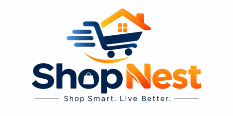

<p align="center">
  
</p>

<h1 align="center">ShopNest 🛍️</h1>

<p align="center"><strong>A simple online shop for Bangladesh</strong><br>Daraz-style shopping — 450 products, 15 categories, login, cart, checkout, order tracking & an admin dashboard.</p>

<p align="center">
  <a href="https://rohitghoshrg.github.io/shopnest/"><strong>🌐 Live Demo</strong></a>
  &nbsp;•&nbsp;
  <a href="#-how-to-run-it">How to run</a>
  &nbsp;•&nbsp;
  <a href="#-features">Features</a>
  &nbsp;•&nbsp;
  <a href="#-firebase-setup">Firebase setup</a>
</p>

<p align="center">
  
  
  
  
  
  
</p>

---

## ✨ Features

| Feature | What it does |
| --- | --- |
| 🔐 Login & sign up | Email/password accounts with Firebase Auth |
| 🛒 Cart | Add products, change quantities, **BLACK20** coupon (20% off on ৳1000+) |
| 💳 Checkout | Name, phone, address, district, delivery zone & payment method |
| 📦 Order tracking | Every order gets an `SN-` number — track it: Placed → Processing → Shipped → Delivered |
| 👑 Admin dashboard | Total orders, total sales, all orders, all customers — plus a **"Seed 450 products"** button |
| 👤 Profile page | My Orders, Track Order, dark mode, Logout, Delete Account |
| 🌙 Dark mode | One switch, whole shop goes dark |
| 📱 Responsive | Works on phone and desktop |

> No clever tricks are used in this code. Every file starts with a short comment that says what the file does, and variable names are full words — you can read the code like a story.

## 🛠️ Tech stack

| Layer | Tech |
| --- | --- |
| Markup & style | HTML5, CSS3 (custom properties, dark mode) |
| Logic | Vanilla JavaScript (no framework) |
| Auth & database | Firebase Auth, Cloud Firestore |
| Hosting | GitHub Pages (free) |

## 📁 Project structure

```
shopnest/
├── index.html          # The one page: header, main area, pop-ups (login, cart, checkout)
├── css/
│   └── style.css       # Colours, cards, pop-ups, dark mode — colours in :root at the top
├── js/
│   ├── main.js         # Starting point — connects all parts, shows the first page
│   ├── firebase.js     # Firebase config + loads Firebase only when needed
│   ├── data.js         # All 450 products and 15 categories
│   ├── auth.js         # Login / sign up, who is logged in, who is the admin
│   ├── shop.js         # Home, categories, search, product pop-up, page routing (#/cat/...)
│   ├── cart.js         # Cart + BLACK20 coupon
│   ├── checkout.js     # Checkout, placing orders, tracking by SN- number
│   ├── admin.js        # Admin dashboard + "Seed 450 products"
│   └── profile.js      # Profile page + dark mode switch
├── firestore.rules     # Database safety rules — paste into Firebase Console > Rules
├── logo.png / logo-mark.png / favicon.png
├── GITHUB.md           # Plain-words guide to pushing this code to GitHub
└── .gitignore          # Blocks node_modules and serviceAccountKey.json
```

## 🚀 How to run it

1. Open this folder in **VS Code**.
2. Install the **Live Server** extension.
3. Right-click `index.html` → **Open with Live Server**.
4. The shop opens at `http://127.0.0.1:5500` (or similar).

> ⚠️ **Do NOT double-click `index.html`.** That opens it as a file and login will not work — the shop must be served over http. If you see only the header and footer and no products, you opened it as a file. Use Live Server (or `python -m http.server 8000` in this folder, then open `http://localhost:8000`).

## 🛒 How shopping works

**Sign up & log in**
1. Click **Login / Sign Up** in the header.
2. New here? Click **No account? Sign up**, type your name, email and a password (at least 6 characters), and press **Sign Up**. The account is made in Firebase Auth.
3. Later, log in with the same email and password.
4. You can look around without logging in — but to buy something you must log in first.

**Buy something**
1. Find a product → **Add to Cart** (or **Buy Now**).
2. Open the cart → **Checkout**.
3. Fill in name, phone, full address, district, delivery zone and payment method → **Place Order**.
4. The order gets a number like `SN-1234567890`. Write it down — you need it to track the order.
5. If Firebase is set up, the order is saved online in Firestore. If not, it is saved in your browser instead, so nothing is lost.

**Track an order** — Go to **My Orders** or your Profile page, type the `SN-` number and press **Track Order**.

## 🔧 Change things

| Change | Where |
| --- | --- |
| 💰 A price | `js/data.js` — find the product id (e.g. `"headphones-01"`), change `"price"` |
| 🖼️ A product photo | `js/data.js` — change the product's `"image"` link |
| 🎟️ The coupon | `js/cart.js` — `discountFor` (coupon `BLACK20`, `0.2` = 20%, min ৳1000) |
| 🚚 Delivery charge | `js/checkout.js` — `deliveryFor` (80৳ inside Dhaka, 120৳ outside) |
| 👑 The admin (owner) | `js/firebase.js` (`ADMIN_EMAIL`) **AND** `firestore.rules` (`request.auth.token.email`) — both must match |
| 🎨 The colours | `css/style.css` — `:root` at the top (`--orange`, `--pink`, `--cream`) |

## 🔥 Firebase setup

The shop already has a Firebase project set up: **ShopNest**, project id `shopnest-76167`, free Spark plan.

To set it up again from scratch:

1. Go to [console.firebase.google.com](https://console.firebase.google.com) → add a project named `shopnest` (free Spark plan is fine).
2. **Build → Authentication → Sign-in method** → enable **Email/Password**.
3. **Build → Firestore Database** → Create database, production mode, location `asia-south1`.
4. **Project settings (⚙️) → Your apps → Web app** → copy the config and paste it into `js/firebase.js`.
5. **Firestore Database → Rules** → paste in the whole `firestore.rules` file → **Publish**.
6. Log in with the owner email, open **Admin**, and click **"Seed 450 products to Firestore"**.

Until step 4 is done, the shop still works locally: products show from `js/data.js`, orders save in the browser, and a yellow banner says Firebase is not configured yet.

> 🔑 `js/firebase.js` holds the normal **web** keys (apiKey, projectId…) for a Firebase web app — they are meant to be in the code; the real safety comes from `firestore.rules`, not from hiding these keys. But **NEVER** put a service account key (`serviceAccountKey.json`) in the repo — `.gitignore` already blocks it.

## ❓ If something goes wrong

| Problem | Fix |
| --- | --- |
| Page is blank (only header & footer) | You opened the file by double-clicking. Use Live Server. |
| "Email already in use" on sign up | The account already exists — click **Have an account? Login**. |
| "Wrong email or password" | Check the spelling — the shop password is separate from your Gmail password. |
| "Seed failed: Missing or insufficient permissions" | Firestore rules are not published yet — do step 5 above, wait a minute, press Seed again. |
| Product photos are blank | Check your internet — photos come from Unsplash; a fallback photo shows if one fails. |

---

<p align="center">Made with ❤️ in Bangladesh 🇧🇩</p>
